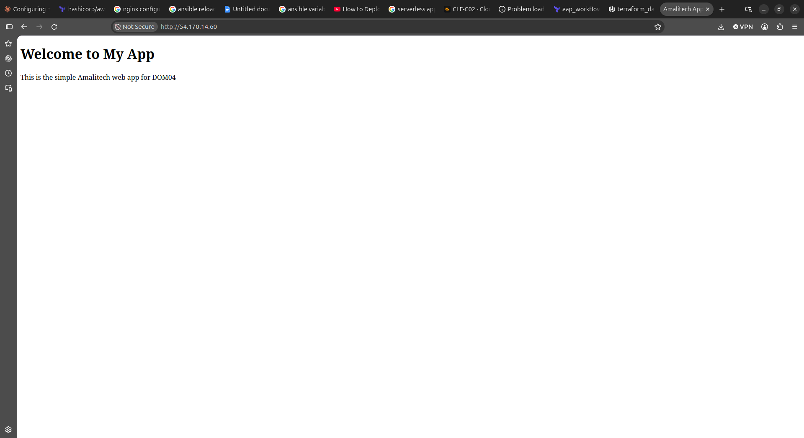
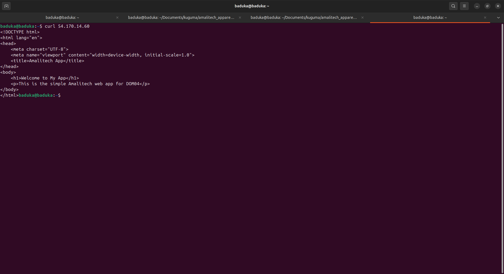
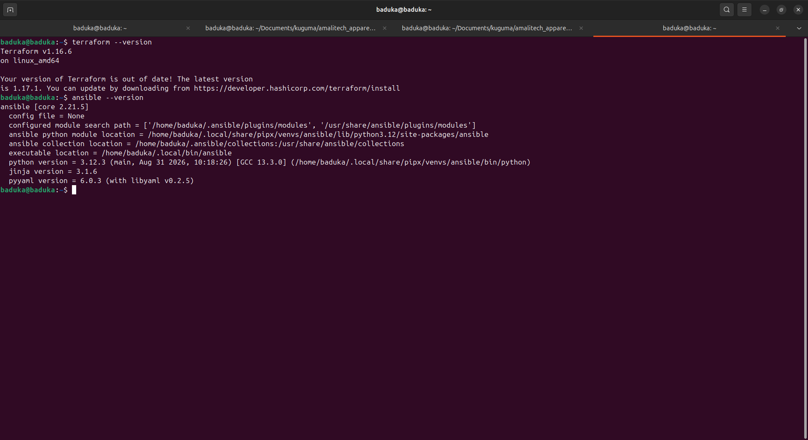

# Advanced IaC: Terraform + Ansible

Provision an AWS web server with **Terraform** and configure it with **Ansible**, all from a single `terraform apply`.

## Background

I first practiced Ansible on its own in a separate repo:
**[Mbaduko/ansible-practice](https://github.com/Mbaduko/ansible-practice.git)**

There I wrote a playbook that installs and configures Nginx using a hand-written inventory. In this project I brought that Ansible work over and combined it with Terraform:

- **Terraform** creates the infrastructure (VPC, subnet, security group, SSH key, EC2 instance).
- Terraform **generates the Ansible inventory** from the instance's outputs, so nothing is copied by hand.
- Terraform then **runs the playbook**, which installs Nginx and deploys the site.

## How it works

```
terraform apply
   ├── module.network  → VPC, subnet, internet gateway, route table
   ├── module.server   → SSH key pair, security group (22, 80), EC2 (Amazon Linux 2023)
   ├── local_file      → writes ansible/inventory/inventory.ini with the server IP and key
   └── terraform_data  → runs: ansible-playbook site.yml
                              └── installs Nginx, deploys index.html and the site config
```

## Project structure

```
.
├── main.tf                  # Calls the modules, writes the inventory, runs Ansible
├── variables.tf / output.tf / providers.tf / versions.tf
├── backend.tf               # S3 backend (values come from backend.hcl)
├── backend.hcl.example      # Template for backend.hcl
├── modules/
│   ├── network/             # VPC, subnet, internet gateway, routing
│   └── server/              # Key pair, security group, EC2 instance
├── remoteback/              # One-time setup: S3 bucket + KMS key for remote state
├── ansible/
│   ├── ansible.cfg
│   ├── site.yml             # Nginx playbook
│   └── templates/           # index.html, nginx.conf.j2
├── APPLY.txt                # Output of terraform apply
└── DESTROY.txt              # Output of terraform destroy
```

## Prerequisites

- Terraform >= 1.5
- Ansible
- AWS credentials configured (`aws configure`)

## Usage

**1. Create the remote state backend (once)**
```bash
cd remoteback
terraform init && terraform apply
cd ..
```

**2. Configure the backend**
```bash
cp backend.hcl.example backend.hcl   # fill in bucket, key, region, KMS key
terraform init -backend-config=backend.hcl
```

**3. Deploy and configure the server**
```bash
terraform apply -var="ssh_cidr=$(curl -s https://checkip.amazonaws.com)/32"
```
`ssh_cidr` restricts SSH to your current public IP.

**4. Open the app**
```bash
terraform output server
curl http://<server_public_ip>
```

**5. SSH into the server (optional)**
```bash
ssh -i ~/.ssh/Dom04-server_key.pem ec2-user@<server_public_ip>
```

**6. Clean up**
```bash
terraform destroy -var="ssh_cidr=$(curl -s https://checkip.amazonaws.com)/32"
```

## Results

Full logs: [APPLY.txt](APPLY.txt) and [DESTROY.txt](DESTROY.txt).

### App in the browser



### curl



## Tools evidence


